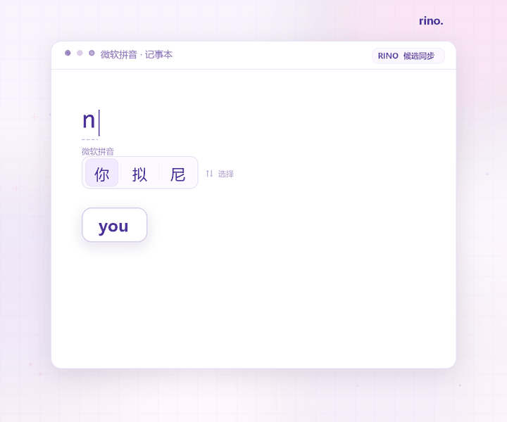
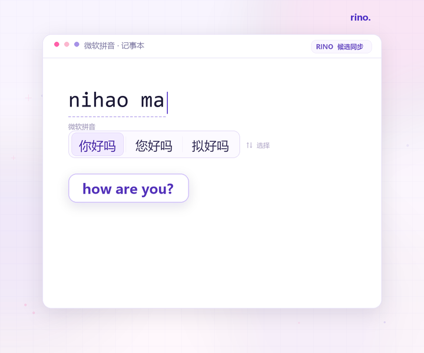

<h1 align="center">RINO</h1>

<p align="center">RINO 读取微软拼音的当前候选，在输入法旁同步显示目标语言译文。输入不变，焦点不抢，译文只在你需要的时候出现。</p>

<p align="center">
  <a href="https://github.com/1716285375/Rino/releases"></a>
  
  
  
</p>

<p align="center">
  
  
  
  
  
  
</p>

<p align="center">
  
</p>

## 使用方式

1. 打开 RINO，选择目标语言。
2. 在编辑器、聊天框或搜索框里照常使用微软拼音。
3. 候选出现时，浮窗在候选旁显示译文；上下键切换候选、回退、提交时，译文同步更新或立即收起。


<p align="center">
  
</p>

## 主要功能

- **候选同步**：读取微软拼音的候选与当前选中项，译文跟着候选走。
- **贴近输入**：浮窗定位在候选附近，支持多显示器和不同缩放比例。
- **本地优先**：输入记录、生词本和设置保存在本机；云端翻译默认关闭。
- **模型可选**：Ollama、llama.cpp、DeepSeek、OpenAI、Anthropic、Gemini、OpenRouter 等。
- **生词本**：从输入记录一键收藏，按间隔重复复习。
- **轻量界面**：原生 Tauri 窗口，跟随系统主题，支持暗色模式。

## 下载

Windows 10 / 11 便携版，免安装。到 [Releases](https://github.com/1716285375/Rino/releases/latest) 下载对应压缩包：

- `RINO_*_windows_x64_portable.zip`
- `RINO_*_windows_x86_portable.zip`

解压后双击 `RINO.exe`。Windows 11 已自带 WebView2；Windows 10 若首次启动提示缺少 WebView2，请安装 Microsoft Edge WebView2 Runtime。

## 从源码运行

需要 Windows 10/11、Visual Studio Build Tools 2022（C++ 桌面开发）、Rust stable MSVC、Node.js 22+。

```powershell
cd Rino
powershell -ExecutionPolicy Bypass -File .\scripts\dev-windows.ps1
```

构建：

```powershell
powershell -ExecutionPolicy Bypass -File .\scripts\build-windows.ps1
```

首次构建会下载固定版本的 Sakuga VFX 组件。模型权重不随程序分发，需要自行通过 Ollama 或 llama.cpp 下载。


## 隐私

候选文本只在需要翻译时离开本机；默认关闭云端翻译。API Key 保存在 Windows Credential Manager，不写入配置文件。输入记录和生词本仅存于本机。

## License

MIT。第三方组件与词典许可见 [THIRD_PARTY_NOTICES.md](THIRD_PARTY_NOTICES.md)。